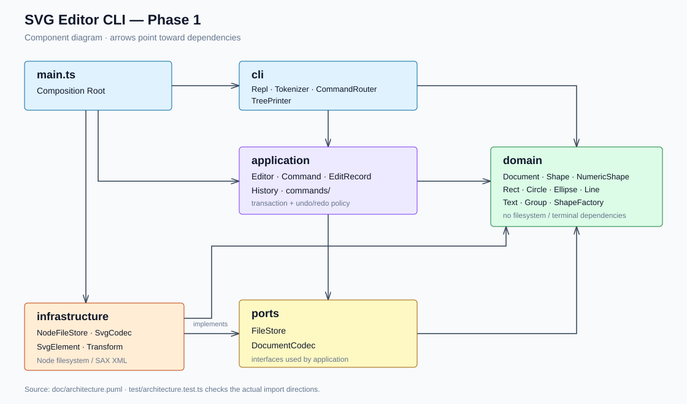
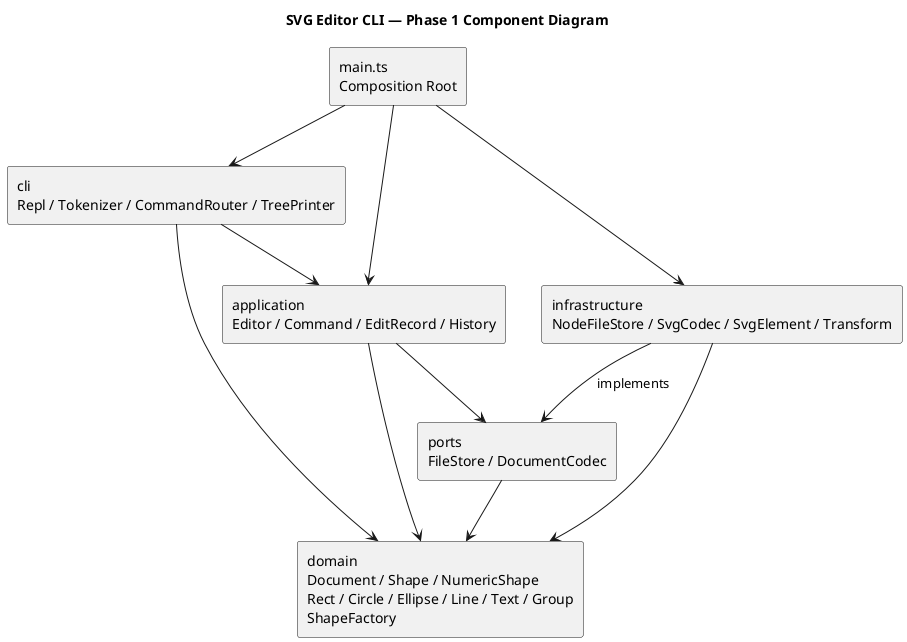

# Lab1 Phase 1：SVG 编辑器（CLI）

> TypeScript 面向对象实现；由 Codex 协作完成。本文件为作业要求的正式文档，位于工程的 `doc/README.md`。

- Git 仓库：[yjs14/gaojiruankai-lab1](https://github.com/yjs14/gaojiruankai-lab1)
- Git 克隆地址：`https://github.com/yjs14/gaojiruankai-lab1.git`
- 最终提交标签：`final`。
- 本地验证：2026-10-30；TypeScript 严格检查通过，自动化测试 **67/67 通过**。
- 远程提交状态：代码已推送到上述 GitHub 仓库；最终交付使用 `final` 标签，并核验该标签对应提交与远程 `main` 一致。

## 1. 运行与验收入口

### 1.1 环境与启动

需要 Node.js 22 或以上版本，以及 npm。已在 Node.js 24.22.1、Windows 环境实际构建和执行测试。

```sh
git clone https://github.com/yjs14/gaojiruankai-lab1.git
cd gaojiruankai-lab1
npm install
npm run build
npm test
npm run cli
```

仓库同时提交了 `pnpm-lock.yaml`。需要按锁文件安装时，可使用 pnpm 11：`pnpm install --frozen-lockfile`，然后运行 `pnpm run build`、`pnpm test`、`pnpm run cli`。本次环境未提供 npm 命令，实际使用 pnpm 11.25.0 安装依赖，并直接运行与 npm 脚本相同的 TypeScript 编译器和 Node 测试命令。

终端交互提示符为 `svg> `。输入 `help` 查看全部命令。EOF 结束程序；Windows 可按 Ctrl+Z 再回车。通过标准输入回放时不打印交互提示符，保证输出便于保存与比较。`#` 开头的行作为注释；颜色参数中的 `#` 不作为注释。

### 1.2 示例回放

Windows PowerShell：

```powershell
Get-Content -Encoding UTF8 examples/flowchart.cli | node dist/src/main.js
Get-Content -Encoding UTF8 examples/session.cli | node dist/src/main.js
```

若终端管道显示中文乱码，先设置 `$OutputEncoding = [System.Text.UTF8Encoding]::new()`。

macOS / Linux：

```sh
node dist/src/main.js < examples/flowchart.cli
node dist/src/main.js < examples/session.cli
```

第一份脚本对应题目 6.1 的版本 A，生成 `examples/flowchart.svg`；第二份对应题目第 6 节会话，读取 `examples/other.svg`。可直接在浏览器中打开 SVG。脚本输出已实际保存为 `examples/flowchart-output.txt` 和 `examples/session-output.txt`。

流程图脚本最后故意在 `save` 后执行一次 `undo`，应出现 `error: undo not allowed after io command`；完整会话还故意包含一次非法分组。这些是验收用例中的预期错误。

## 2. 架构方案

### 2.1 模块划分与职责

```text
src/
├── main.ts                  # 唯一装配入口
├── cli/                     # 输入解析、命令路由、显示、REPL
├── application/
│   └── commands/            # 每种编辑行为对应的 Command 子类
├── domain/                  # 图形类层次、树结构、不变量、图形工厂
├── ports/                   # 文件系统与文档编解码接口
└── infrastructure/          # Node 文件系统、SVG/XML 适配器
test/                        # 行为、IO、架构、真实 REPL 集成测试
examples/                    # 可重放命令、外部 SVG、生成结果和输出
doc/                         # 本 README、初始方案、图与验证日志
```

| 模块 | 核心类 / 接口 | 职责 |
|---|---|---|
| `domain` | `Shape`、`NumericShape`、`Rect`、`Circle`、`Ellipse`、`Line`、`Text`、`Group`、`Document`、`ShapeFactory` | 封装几何与样式；通过多态移动、缩放、设置属性；维护 id 唯一性、父子结构、顺序和环检测。 |
| `application` | `Command`、`EditRecord`、`History`、`Editor` | 执行编辑用例；控制事务、撤销重做、IO 屏障以及当前文档与路径。 |
| `application/commands` | `CreateCommand` 等九个具体命令类 | 封装编辑请求的目标和参数；`OrderCommand` 用方向参数承载 front/back 两种操作。 |
| `ports` | `FileStore`、`DocumentCodec` | 声明 IO 契约，允许应用层替换文件系统与编码实现。 |
| `infrastructure` | `NodeFileStore`、`SvgCodec`、`SvgElement`、`Transform` | UTF-8 文件读写、同目录临时文件保存、严格 XML 解析、SVG 序列化与支持的变换归一化。 |
| `cli` | `Token`、`Tokenizer`、`CommandRouter`、`TreePrinter`、`Repl` | 识别双引号参数及 in 尾缀；处理所有命令；统一 error 前缀；显示树和属性；逐行等待执行。 |
| `main.ts` | 装配代码 | 注入真实文件系统、SVG 编解码器、Editor 和命令路由，启动 REPL。 |

组件图的箭头表示源码依赖方向。图中的两个接口位于 ports；图的可编辑 PlantUML 源码为 [architecture.puml](architecture.puml)。SVG 展示图与该组件模型保持一致。





### 2.2 设计模式的选择与落地

**Command（必选）。** `Command` 声明 `execute(document)`，创建、删除、移动、缩放、设置、分组、解组、移入容器、调整顺序分别由具体类实现。路由只负责把字符串转换成请求，不承担编辑算法。`Editor.execute` 通过 `History` 执行命令；显示命令跳过历史，文档命令由 Editor 独立处理。

**Memento。** `EditRecord` 包装一个 Command，保存编辑前后两个深拷贝，并提供 `execute / undo / redo`。命令在候选文档上执行；只有成功后才提交候选文档并更新历史，因此错误不会污染文档、当前路径、已有 undo/redo 栈。撤销直接恢复前快照，重做恢复后快照，不会再次运行命令造成重复创建或重复分配 id。`group g a b` 与删除整棵子树均只有一个历史单元。

采用文档快照的理由是本阶段数据规模小，而跨父容器分组、节点位置恢复和整体删除的逆操作较复杂。代价是每次编辑 O(n) 的复制时间和 O(n) 的历史存储；以后出现大文档性能需求再替换为局部差量，不预先实现一套复杂的逆操作系统。

**Composite。** `Group` 和各叶子图形都继承 Shape。`Group.move / scale` 递归调用子节点的同名方法，命令无需根据图形类型分支。`delete` 操作整棵子树；`set g fill / stroke / stroke-width` 设置 SVG 容器样式，遵循 SVG 继承规则，子图形显式设置的样式仍有优先级。普通 g 没有 x、y 等几何属性，`set g x` 会按白名单拒绝。

**简单工厂与依赖倒置。** `ShapeFactory` 的定义表把六个类型名映射到对应构造器和参数 schema；`Editor` 依赖 FileStore、DocumentCodec 接口，由 main 注入适配器。测试使用 MemoryFileStore，不访问真实用户文件。

**按名字分派只保留两处，均记为后续插件化阶段的待重构点：**

1. `cli/CommandRouter.ts`：命令名 → 已注册处理器。
2. `domain/ShapeFactory.ts`：图形类型名 → 构造器及参数定义。

两处目前内置定义表，尚无动态注册、插件发现和卸载机制，不能声称已完成插件化。几何操作、文本能力、序列化和显示均通过多态方法或能力属性访问，不散布 `switch(tag)`。

### 2.3 依赖方向规则

| 依赖方 | 可依赖对象 | 理由 |
|---|---|---|
| domain | domain 自身 | 核心模型不感知终端、文件系统和第三方 XML 库。 |
| ports | ports、domain | 编解码契约可以使用领域 Document 类型。 |
| application | application、ports、domain | 只编排领域行为与接口，不绑定具体 IO。 |
| infrastructure | infrastructure、ports、domain；Node 内置模块与 sax | 实现边界接口，负责外部格式转换。 |
| cli | cli、application、domain；Node 内置模块 | 输入转换成命令，读取领域的查询结果；不直接访问具体文件适配器。 |
| main.ts | 以上全部生产模块 | 唯一组合根，负责创建并注入具体实现。 |
| test | 生产模块及测试依赖 | 测试装配可跨层，生产模块不得反向依赖 test。 |

`test/architecture.test.ts` 使用 TypeScript AST 检查所有生产文件的静态 import，验证以上层间规则及一类一文件、文件名等于类名。该检查能约束静态依赖，不能替代人工审查职责边界，也不证明所有未来动态导入都安全。

### 2.4 变化点假设

| 可能变化 | 当前准备或暂不准备的理由 |
|---|---|
| 增加图形类型及未来 box 插件 | Shape 的多态接口和 ShapeFactory 集中类型定义；本阶段 `create box` 必须报 unknown shape type。未来把工厂表替换为 ShapeProvider 注册，补充 data-kind 语义、派生 id 与属性传播；当前不虚构插件能力。 |
| 增加 GUI / agent 等输入通道 | 编辑行为位于 application/commands，独立于 CLI 字符串。新入口可直接构造 Command；当前没有引入事件总线或 GUI 框架。 |
| 文件存储由本地变为远程或内存 | FileStore 接口隔离异步读写；MemoryFileStore 已在测试中替换真实文件。 |
| SVG 支持范围扩大或新增格式 | DocumentCodec 接口隔离读写；SvgCodec 负责格式细节；暂不为尚未要求的 path、CSS、defs、任意变换设计完整模型。 |
| 文档规模或撤销历史变大 | EditRecord 集中管理快照；以后可替换为局部 Memento 或逆操作。目前选择正确性优先，记录全量复制与无限历史的成本。 |
| 新命令与参数形式 | 命令定义集中在 CommandRouter；后续抽出注册来源。当前双引号和可选 in 已够用，不提前引入完整 shell 语法。 |

## 3. 行为约定与阶段边界

- 支持全部 19 个命令名：`init/read/save/canvas/create/delete/move/scale/set/group/ungroup/addto/front/back/tree/show/help/undo/redo`。
- 支持 rect、circle、ellipse、line、text、g 六种内置图形。id 区分大小写，全局唯一；CLI 创建必须显式提供 id。
- `scale` 乘到所有几何值，包括位置和尺寸；容器递归作用到每个子孙。stroke-width 是样式，不随几何缩放。
- 图形坐标允许负数和有限浮点数；宽、高、半径及 stroke-width 非负，画布尺寸和缩放因子必须为正数。NaN、Infinity、溢出及非十进制数字输入会被拒绝。
- `create ... in gid` 在创建时指定归属；`addto` 移到目标容器末尾。非法容器、自包含和祖先移入后代均会被拒绝。
- 分组选中的元素按**原文档深度优先顺序**保序，跨父级时新组放到最近公共父容器中最早选中分支的位置；该放置规则是对题目未详述部分作出的确定性约定。其余元素相互顺序不变，undo 恢复全部原父级与位置。
- `ungroup` 只允许解散嵌套普通 g，子节点原位提升；根级 g 按题目要求拒绝。box 未实现，因此不会存在本阶段可解组的 box 实例。
- front 把节点移到同级末尾（SVG 后绘制、视觉更靠前），back 移到同级开头。
- `init/read/save` 成功，以及带尺寸的 canvas 成功，清空旧历史并设置 IO 屏障；两种撤销操作统一报 `error: undo not allowed after io command`，直到下一次成功编辑。无参数 canvas 只是查询，不触发屏障。
- 显示、空行、注释、失败命令不改变历史；undo 后有新成功编辑才清空 redo。
- SVG 采用严格 XML 解析并正确转义特殊字符。读取时先扫描全部显式 id，再补缺失 id 并输出 warning；重复 id 或不支持的图形拒绝整份读取。
- SVG 读写范围是本阶段六种图形、列明的几何与公共样式、嵌套 g，以及可归一化的 translate / 正数等比 scale。支持同画布的 `viewBox="0 0 w h"`。未知属性、CSS/style、font-size/text-anchor、非匹配 viewBox、rotate、非等比缩放、path、脚本与 DOCTYPE 等会明确拒绝，不宣称支持所有外部 SVG。输入没有几何属性时按 0 补默认值。
- 外部 `g data-kind="box"` 在没有插件时降级为普通 g；本阶段不保存其插件类型标记，也不保证插件专属语义往返。
- tree 使用完整 width/height 属性名并内联几何值；undo/redo 摘要使用 `undone:` / `redone:` 前缀。排版和示例不逐字相同，结构、参数与实际状态已测试。

## 4. 过程记录

以下记录本次实际发生的实现与检查，不将 AI 生成的建议写成未经执行的实验结论。

| 迭代 | 发现的问题 / 决策依据 | 修正与验证 |
|---|---|---|
| 需求拆解 | 用户交付物是 README，但原始作业同时要求代码、真实远程仓库、分步提交与 final 标签；仅撰写架构设想不足以对应实现。 | 先建立工程、初始设计 PLAN.md 和第一次 Git 提交，再逐步实现，最后依据实际代码撰写本文件。 |
| 图形建模 | 每个命令内部识别 rect/circle/g 容易形成按 tag 到处分派；公开属性袋也不满足面向对象要求。 | Shape 定义行为，NumericShape 封装数值几何与校验，具体类型各一文件，Group 递归委派。类型识别集中到工厂。 |
| 撤销实现 | 对 group/delete/addto 手写反向操作容易漏掉原父级、插入索引和子孙结构；容器修改中途溢出还会造成半成功。 | 使用 Command + EditRecord 快照事务。在文档副本执行，成功后才提交；以跨父级分组、子树删除和第二个子孙溢出测试验证完整恢复。 |
| 文本和显示检查 | 首轮读写/显示代码曾直接判断文本 tag，容易让新类型继续引入条件分派。 | 改为 Shape.acceptsText 能力属性，由 Text 覆盖；编译与 round-trip 测试确认结果一致。 |
| 自动命名 | 若边读边给无名 rect 分配 rect1，可能与文件后面显式的 rect1 冲突。 | 读取时先保留所有显式 id，再从未占用序号分配。测试验证无名 rect 得到 rect2，而显式 rect1 保留。 |
| 第一轮自动测试 | 66 项中 65 项通过；转义引号用例失败。检查后确认是测试源字符串未保留预期反斜杠，并非词法器应接受不配对引号。 | 用 JSON.stringify 产生含转义双引号的真实命令输入；复测 66/66 通过，没有通过放宽词法器来掩盖错误。 |
| 集成验收 | 单元测试不能证明真实 stdin、EOF、保存文件和整段示例可共同工作。 | 回放题目第 6 节与 6.1 的脚本，保存实际输出和 SVG；新增真实 REPL 子进程测试，达到 67/67 通过。 |
| 远程仓库 | 用户提供真实仓库地址；初始检查为空仓库。插件授权没有自动提供本机 Git 凭据，隔离环境也不能使用用户的 Windows 凭据存储。 | 用户通过 Git Credential Manager 完成设备登录后，在系统用户环境成功推送完整分步历史；最终推送 main 与 final，并通过远程引用哈希检查交付。 |

### 4.1 方案修订记录

- 初始方案保留在 `doc/PLAN.md`，提交早于领域实现，作为设计基线。
- 补充 `NumericShape`，提取公共数值校验、移动与缩放；属于 domain 内部细化，没有改变模块依赖。
- 将 undo/redo 快照包装命名为 EditRecord；History 管理双栈与屏障，Editor 负责当前文档和 IO。没有把历史栈放进图形模型。
- 新增 `SvgElement` 与 `Transform`，分别封装 XML 临时树和支持的变换归一化，均位于 infrastructure。
- front/back 共用 OrderCommand，避免两个只差一个方向参数的类。
- 最终补充 test/repl.test.ts、examples 和图示产物，不改变生产模块依赖。

## 5. 一致性自查

### 5.1 模块划分是否一致？

**一致。** 实际生产目录为 cli/application/domain/ports/infrastructure，main.ts 为组合根，与初始方案吻合。NumericShape、EditRecord 及 SVG 辅助类的细化已记入上面的修订记录。没有把 CLI 或文件系统逻辑塞入 domain；实际每个生产类均独立成文件，文件名等于类名。

### 5.2 依赖方向是否违反规则？

**当前静态 import 检查未发现违反。** 自动测试扫描生产源码，按第 2.3 节白名单检查；并做以下人工抽样：

| 抽查文件 | 实际依赖 | 结论 |
|---|---|---|
| `domain/Document.ts` | 同层 Group、Shape | 不依赖 CLI、IO 或命令。 |
| `application/Editor.ts` | domain/Document、ports 两接口、同层 Command/History | 不依赖 NodeFileStore、SvgCodec。 |
| `application/commands/MoveCommand.ts` | application/Command、domain/Document | 通过 shape.move 多态执行，不识别图形类型。 |
| `infrastructure/SvgCodec.ts` | ports、domain、同层解析辅助类、sax | 外部格式留在适配层。 |
| `cli/CommandRouter.ts` | application、domain、同层解析显示类 | 不直接依赖具体文件系统或 SVG 编码实现。 |
| `main.ts` | Editor、真实适配器、路由和 Repl | 属于明确允许的装配依赖。 |

两处基于名字的内置注册表属于**已经标注的后续插件化待重构项**；它们没有违反上述模块依赖，但仍需要后续阶段替换为插件来源，不能把“当前规则通过”理解为“所有扩展性问题已解决”。

## 6. 质量保证手段

### 6.1 已执行的检查

| 检查 | 实际结果 | 能说明什么 |
|---|---|---|
| TypeScript 严格构建 | 通过；启用 strict、noImplicitOverride、noUnusedLocals、noUnusedParameters | 类型、继承覆盖和未使用声明可检查。 |
| 自动化测试 | **67 tests，67 pass，0 fail，0 skipped** | 核心行为与边界已执行验证；原始结果见 [verification.txt](verification.txt)。 |
| 架构 AST 检查 | 通过 | 检查所有源码静态依赖方向、一类一文件和类名/文件名一致。 |
| 第 6 节典型会话 | 回放通过 | 含非法祖先分组、删除撤销、save 后屏障、read 缺 id 警告。 |
| 第 6.1 节流程图 | 回放通过；保存 8 个图形元素 | 嵌套组合移动、一次撤销、中文文本更新和 SVG 保存共同工作。 |
| SVG 往返 | encode → decode → encode 相等 | 六种类型、嵌套、样式、中文和特殊 XML 字符在支持范围内保持。 |
| 真实文件 IO | 临时目录中覆盖保存、读取和错误路径测试通过 | 验证真实文件适配器，测试结束清理自己的临时目录。 |
| SVG 渲染检查 | 架构图和流程图已用 SVG 渲染器转为 PNG 检查 | 图形文件可渲染、标签可见；未声称完成浏览器自动化视觉测试。 |

### 6.2 功能覆盖对应关系

- 文档命令：默认和指定 init；read 成功/失败；缺 id 与重复 id；save 默认路径及另存为；canvas 查询/修改。
- 图形命令：六种类型、可选颜色、可选 in、全部几何属性和公共样式、文本内容、容器嵌套操作。
- 树结构：同级与跨父级 group、根级解组拒绝、嵌套解组原位替换、addto 环检测、同级 front/back、整棵子树删除与恢复。
- 历史：每条编辑一单元；undo/redo 对称；新成功编辑清空 redo；查询和错误保留 redo；IO 成功设屏障，IO 失败保留旧状态与历史。
- 输入和显示：中文与空格、空字符串、转义引号、颜色 #、注释、非法参数和浮点数校验；tree 内联属性、子树过滤、show 父级信息、help 语法列表。
- 故障原子性：错误后比较整个 SVG 快照；还检查 redo 能否恢复先前结果，防止只比较文档却漏掉历史污染。

### 6.3 信心的边界

测试支撑本阶段定义范围内的功能，不代表完整 SVG 标准兼容。当前未做大文档性能基准、历史容量限制或插件系统；不支持范围已列明。题目未提供具体截止时间，因此不对“早于截止时间”作无依据声明，实际以远程 final 标签的时间和课程截止要求核对。

## 7. Git 提交与验收

开发按“工程与设计 → 领域与历史 → CLI/IO 与测试 → 示例和正式文档 → 远程交付记录”分步提交，保留真实开发历史，没有倒填提交时间或把一个大提交拆成虚构过程。仓库本地作者暂使用中性的 `SVG Lab Contributor <svg-lab@users.noreply.local>`，未冒充用户的姓名或邮箱。

```sh
git log --oneline --reverse
git status --short
git show final --stat
git ls-remote origin refs/heads/main refs/tags/final 'refs/tags/final^{}'
```

完整开发历史已提交至上述 Git 仓库；**远程 `main` 与 `final` 标签均存在，`final` 解引用后指向 `main` 的最终提交。** 验收时可使用上面的命令复核，避免只检查本地标签。
